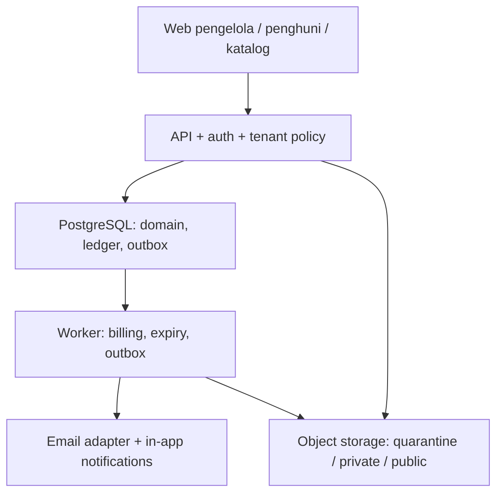

# Arsitektur, data dan keamanan — v1.0.0

Baseline engineering untuk implementasi; tidak menyatakan infrastruktur sudah dibuat.

## ADR yang diputuskan dalam spesifikasi

| ADR | Keputusan baseline | Alasan / batas |
|---|---|---|
| ADR-01 | Modular monolith TypeScript; React + shadcn/ui untuk UI, Fastify API, PostgreSQL | Satu deployment domain bisnis lebih mudah diuji; frontend mockup Vite dapat diadaptasi |
| ADR-02 | Shared schema organization_id + application authorization + PostgreSQL RLS | Isolasi berlapis; RLS bukan pengganti permission dan composite FK |
| ADR-03 | SQL jobs dan transactional outbox + worker terpisah | Tidak memerlukan Redis untuk pilot; at-least-once dan idempotensi wajib |
| ADR-04 | S3-compatible private object storage + public derivatives terpisah | Vendor/region dipilih saat provisioning; core tidak bergantung vendor |
| ADR-05 | Session cookie HttpOnly, Secure, SameSite dan CSRF protection; web/API same origin | Tidak menyimpan bearer/service-role secret di localStorage |
| ADR-06 | Transfer/cash diverifikasi manusia; refund dilaksanakan pemilik di bank | Tidak ada escrow/gateway pada v1.0 |
| ADR-07 | Draft/pending tidak menahan inventori; allocation constraint wajib | Mencegah double booking lintas proses, bukan hanya tombol disabled |
| ADR-08 | Lease, presence, allocation, condition dan ledger dipisahkan | Status finansial tidak memindahkan orang atau membuka kamar |
| ADR-09 | Demo database terpisah dari production | localStorage/39 tes prototipe tidak memenuhi release gate |
| ADR-10 | Kontrak versi + account acceptance, bukan tanda tangan tersertifikasi | Identitas penerima server-verified, riwayat versi utuh |

Gunakan runtime LTS dan versi dependency yang masih didukung pada kickoff; pin lewat lockfile dan catat compatibility matrix sebelum staging. Dokumen tidak menetapkan klaim “versi terbaru”. Perubahan stack boleh melalui ADR dengan invariant/acceptance sama, tanpa mengurangi scope diam-diam.

## Komponen



Modul internal: identity, tenancy, inventory, pricing/catalog, inquiry, booking, lease/occupancy, billing/payment/deposit, hospitality, checkout, reporting, SaaS, import. Saling memanggil service/domain API, tidak mengubah tabel ledger/alokasi modul lain lewat handler UI. Worker memakai service account scoped dan selalu membawa organization_id.

## Model data dan constraint wajib

Tabel privat memuat id, organization_id, timestamps, actor/version untuk optimistic concurrency. FK bisnis memakai (organization_id, id); tenant A tidak boleh menunjuk parent tenant B. User global; membership membatasi role/lokasi. Customer/resident profile organisasi tidak dibagikan lintas tenant, walaupun email login sama.

| Kelompok | Tabel inti | Constraint / invariant |
|---|---|---|
| Identity | users, sessions, verification_tokens, mfa_methods | Email normalized unique; token hashed, single-use, expiry; revoke session efektif request berikut |
| Tenancy | organizations, memberships, location_access, support_grants | Membership unique; minimal satu Owner; bantuan admin time-bound dan audit |
| Inventory | properties, room_types, rooms, inventory_items, room_blocks | room code unique property termasuk arsip; kapasitas positif; location timezone valid |
| Pricing/catalog | rate_policy_versions, listings, listing_versions, media | Version monotonik per policy; snapshot immutable; slug publik unique; media scope eksplisit |
| Acquisition | inquiries, viewings, bookings, room_allocations | Idempotency; allocation active tidak overlap; appointment petugas tidak overlap |
| Stay | residents, leases, lease_occupants, lease_segments, room_presence | Source booking unique pada lease; satu presence aktif/kamar; segmen berurutan dan histori tetap |
| Agreements | agreement_versions, agreement_acceptances | Acceptance lease+version+account unique; revisi tidak menimpa dokumen lama |
| Billing | invoices, invoice_lines, invoice_adjustments, payments, payment_proofs, payment_allocations, credits | Nomor invoice/receipt unique organisasi; nominal integer; alokasi tidak melebihi saldo; source/periode unique |
| Deposit/refund | deposit_entries, refund_requests, refund_events | Ledger append-only; saldo nonnegatif; reserve+payout tidak melebihi refundable balance |
| Hospitality | service_tickets, ticket_events, visits, work_orders, inspections, inventory_conditions | State transitions diaudit; consent visit; room_ready command cek blockers |
| Checkout | checkouts, settlement_versions, settlement_allocations | Satu open checkout/lease; physical/financial timestamps terpisah |
| Reporting | expenses, export_jobs, report_read_models | Exports tenant-scoped; posted/void expense tidak dihapus; as-of jelas |
| SaaS | plans, subscriptions, entitlement_events | Kuota dicek di server pada transaction; status restricted tidak menghapus transaksi |
| Migration | import_batches, import_rows, opening_entries, external_refs | Fingerprint+mapping+tenant unique; external refs unique; dry-run sama dengan commit |
| Reliability | idempotency_requests, jobs, outbox_events, delivery_attempts, audit_logs | Unique key + payload hash; retry-safe; no duplicate external delivery status |

### Constraint interval (pola implementasi, bukan full migration)

```sql
CREATE EXTENSION IF NOT EXISTS btree_gist;
-- Gunakan organization_id UUID, room_id UUID, starts_on DATE,
-- ends_on DATE nullable, state enum/text tervalidasi di migration final.
ALTER TABLE room_allocations
  ADD CONSTRAINT allocation_dates CHECK
    (ends_on IS NULL OR ends_on > starts_on);
ALTER TABLE room_allocations
  ADD CONSTRAINT room_allocation_no_overlap
  EXCLUDE USING gist
  (organization_id WITH =, room_id WITH =,
   daterange(starts_on, ends_on, '[)') WITH &&)
  WHERE (state = 'active');
CREATE UNIQUE INDEX room_one_active_presence
  ON room_presence (organization_id, room_id)
  WHERE exited_at IS NULL;
```

Availability query dan write harus memakai representasi interval yang sama. Release allocation memakai state, bukan mengandalkan predicate NOW() pada index. Booking/expiry/check-in lock source row dan room konsisten. UUID bukan pengganti authorization. Detail DDL seluruh tabel, migration forward/backward, index query plan dan RLS policy adalah deliverable backlog B01/B02, bukan dianggap selesai oleh contoh SQL ini.

## Batas transaksi

| Command | Harus commit/rollback bersama |
|---|---|
| accept booking | booking, allocation, invoice awal, audit, outbox, idempotency result |
| verify payment | payment, line/invoice allocations, credit/deposit entries, receipt, booking transition, audit/outbox |
| refund paid | approval validation, saldo reservation/payout ledger, payment/receipt reference, audit/outbox |
| check-in | lease state, presence, allocation, inspection/inventory/key snapshot, audit/outbox |
| move execute | source+target lock, old/new segment+presence+allocation, adjustments, dirty/turnover, audit/outbox |
| checkout physical | presence exit, actual allocation end/release, room dirty, final inspection, turnover, audit/outbox |
| routine invoice | unique period invoice, line snapshot, outbox, job execution record |
| import commit | batch checksum, live entities/opening ledgers, reconciliation result, audit |

Database transaction tidak mencakup transfer bank, SMTP atau object upload. Gunakan staging object/quarantine dan outbox, lalu cleanup orphan. Kegagalan email tidak membatalkan pembayaran verified; kegagalan commit tidak mengirim email sukses. Idempotency key terikat organization+actor+command+payload hash, valid untuk retry yang dikembalikan server; simpan selama retry window dan source immutable transaction tetap unique setelah key dipurge.

## Matriks izin minimum

| Aksi | Owner | Manager (lokasi) | Finance (lokasi) | Operasional (lokasi) | Penghuni |
|---|---|---|---|---|---|
| Organisasi/staf/paket/rekening | Ya | Tidak | Baca rekening tujuan | Tidak | Tidak |
| Inventori/listing/tarif | Ya | Ya sesuai permission | Baca biaya relevan | Kondisi/tugas saja | Katalog publik |
| Inquiry/booking | Ya | Ya | Baca transaksi terkait | Jadwal kedatangan terbatas | Milik sendiri |
| Invoice/payment verify | Ya | Default tidak verify | Ya | Tidak; cash hanya delegasi eksplisit | Lihat/bukti milik sendiri |
| Refund/deposit approval/reversal | Ya | Default tidak | Usul & catat payout setelah approval | Tidak | Lihat milik sendiri |
| Payment override check-in | Ya + re-auth + reason | Tidak | Tidak | Tidak | Tidak |
| Check-in/out/inspeksi | Ya | Ya | Finansial saja | Checklist fisik; identitas minimum | Consent/permohonan sendiri |
| Tiket/tugas | Ya | Ya | Biaya yang diizinkan | Ditugaskan/lokasi | Milik sendiri |
| Ekspor/audit | Ya | Operasional lokasi | Finansial lokasi | Tidak massal | Dokumen milik sendiri |

Platform Admin hanya platform metadata/plan/health. Akses bantuan tenant memerlukan grant terpisah, expiry, tujuan dan audit terlihat Owner. Integrasi test meliputi denial untuk setiap kolom negatif.

## Auth, file dan privasi

- Password strong hash (Argon2id atau alternatif setara yang direview), rate limit login/reset, email verification wajib sebelum publish/undang staf. Baseline token: verification 24 jam, reset 15 menit, invitation 72 jam; sekali pakai dan dapat dicabut. MFA wajib Platform Admin, Owner/Finance tersedia dan diwajibkan untuk izin refund/rekening sesuai policy rilis. Re-auth perubahan rekening, Owner, delegasi refund.
- Session server-side, idle 30 menit/absolute 12 jam configurable; logout/revoke membership menolak request berikut dan mint URL baru. URL file terlanjur diterbitkan berumur pendek (baseline ≤60 detik) dan dicabut melalui proxy bila perlu revoke segera. Jangan menjanjikan penghapusan file yang sudah diunduh.
- Foto publik: allowlist JPG/PNG/WebP, re-encode, metadata dibuang. Bukti/identitas/perjanjian/inspeksi: quarantine, MIME/signature/size validation, malware scan; PDF/JPG/PNG baseline ≤10 MB; deny executable/SVG aktif. URL privat hanya sesudah izin objek. Dokumen di quarantine belum bisa diunduh pengguna lain.
- Nomor identitas opsional sesuai kebutuhan bisnis, masked, field-level access; jangan menulis NIK, file body, password, token atau bukti bayar dalam log/audit. Tidak mengumpulkan identitas penuh di inquiry.
- Retensi transaksi, identitas, file dan backup merupakan konfigurasi wajib yang disetujui pemilik setelah review kebijakan yang relevan. Paket ini tidak mengklaim jangka waktu tertentu memenuhi hukum. Legal hold menahan purge; anonimisasi tidak merusak ledger. Gate produksi menolak policy kosong.
- Backup terenkripsi harian; target RPO ≤24 jam, RTO ≤8 jam; 30 backup harian adalah baseline operasi yang dapat disesuaikan, bukan retensi transaksi legal. Restore DB+object manifest ke environment terpisah wajib diuji.

## Nonfungsional dan operasional

p95 read ≤800 ms, normal mutation ≤1.500 ms pada staging setara produksi; 100 sesi concurrent campuran, dataset 100 organisasi × 10 lokasi × 100 kamar untuk uji sintetis. Availability SLO target 99,5%/bulan; bukan hasil pengukuran saat ini. LCP publik target ≤2,5 detik pada profil perangkat/jaringan yang direkam. UI 360/768/1280 px, target WCAG 2.2 AA, keyboard, fokus dialog dan target sentuh 44 px. Uji dua versi mayor browser yang didukung saat rilis.

Metrics minimum: availability conflict, transaction rollback, idempotency mismatch, expiry/job lag, scheduler catch-up, outbox retry/dead-letter, receipt/refund invariant, auth denial, private-file denial, import failures. Alert owner teknis dengan runbook. API request ID dan audit correlation tidak mengandung data pribadi penuh.

Lingkungan dev/test/staging/prod terpisah; secrets manager/environment server, migrations versioned, encrypted backups, health/readiness endpoint, error tracking, TLS. Local developer boleh memakai email sink dan object storage emulator; tidak boleh memberi label delivered produksi. Staging tidak memakai dokumen identitas asli tanpa dasar/izin dan kontrol yang sesuai.
